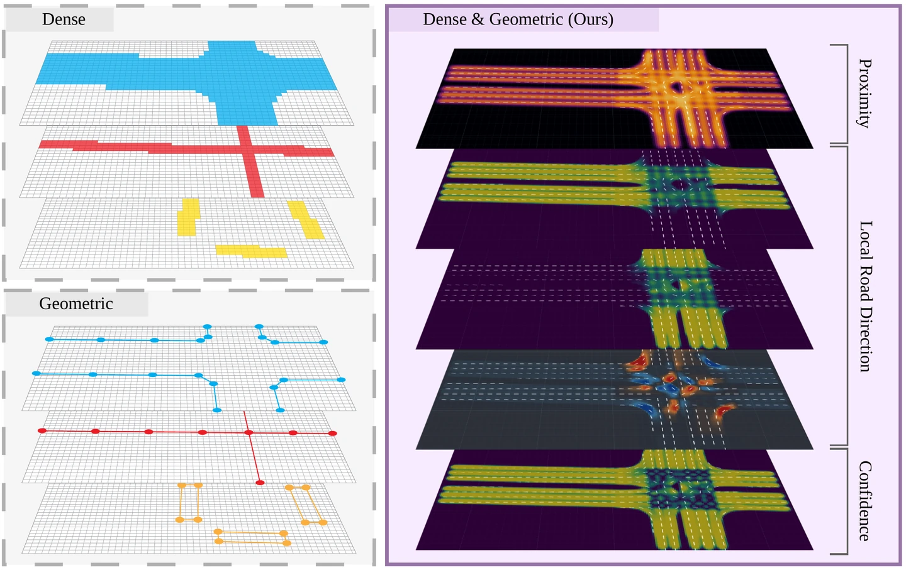
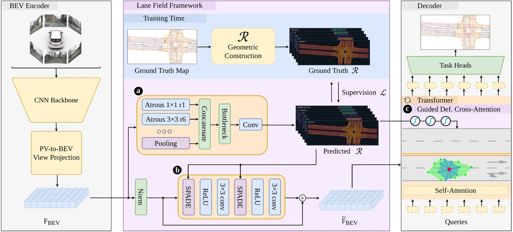

# Learning Lane-Structured Conditioning Fields for Online HD Mapping

**Accepted at WACV 2027 — IEEE/CVF Winter Conference on Applications of Computer Vision.**

  
  

## Abstract

High-definition maps provide critical structural information for downstream autonomous driving tasks. Recent methods increasingly rely on external priors to improve prediction accuracy and robustness. Yet, existing prior representations expose a trade-off: dense rasters are easy to integrate but ignore certain map geometric properties, while sparse vectors preserve geometric structure but require dedicated encoders and are difficult to plug into existing architectures. Moreover, external priors can be inaccurate, costly to acquire, or difficult to maintain, motivating a structural representation that can provide geometric guidance while remaining learnable and broadly applicable. We address this limitation with the Lane Field, a dense BEV-aligned geometric representation that encodes local lane structure at each spatial location and can be either predicted from onboard observations or constructed from external map priors. Building on this representation, we introduce a plug-and-play framework that enhances online HD mapping through two complementary mechanisms: BEV feature modulation, which injects lane-structured cues into latent BEV features, and deformable attention guidance, which steers query sampling toward the underlying lane geometry. We primarily evaluate our method on OpenLane-V2, showing that conditioning BEV features and guiding deformable attention with local lane geometry enables our framework to consistently improve existing methods and achieve state-of-the-art performance on lane segment perception.
